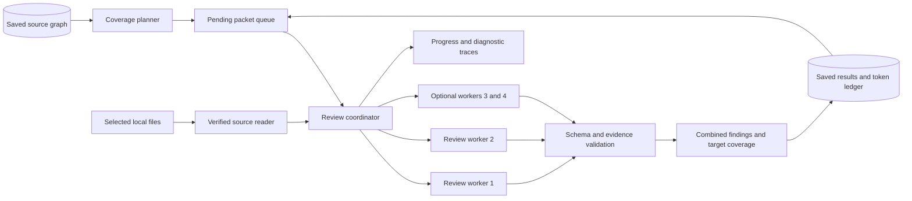

# Parallel static source review

## Problem and scope

Large portfolios create thousands of source-review packets. Sequential provider requests leave the application waiting on one response at a time. The previous source loader also walked and decoded selected repository trees again for each 100-packet window. Parallelism addresses waiting; indexed source reads address local overhead. Neither changes the number of required CWE assessments or guarantees lower model token consumption.

This iteration introduces a small backend execution framework for CWE source review and STRIDE threat-model generation. The source graph, packet planner, evidence validator and saved workspace remain authoritative. It does not add target execution, probing, autonomous tools, a new provider, or another model deployment. Independent evidence investigation retains its existing scheduling. STRIDE workers contribute validated threat scenarios to the shared threat register and matrix; worker completion order does not rewrite the system DFD.

## Responsibilities

- **Planner:** retains scanner-first, graph-interaction and remaining-source priority. Repositories remain interleaved within priority. Every planned record, STRIDE review obligation and all required CWE target assessments remain in scope. Unresolved graph relationships remain coverage gaps.
- **Coordinator:** assigns each selected packet once, with a shared request budget. The default is two concurrent workers, selectable from one to four. Bounded mode selects a total number of packets for the action, not that number per worker. Continuous mode processes the remaining planned scope. Workers use the configured provider and exact deployment name.
- **CWE source reader:** groups planned records by repository and file, reads only those files for the current window, checks selected repository membership, path containment, symlinks, file limits and content hashes, and supplies transient redacted source windows. The initial repository pass still verifies snapshot compatibility. Source text is not added to saved checkpoints or diagnostic traces.
- **Review workers:** submit independent packets and return proposed findings and target assessments. They cannot change scope, invoke tools or write to the inspected repositories.
- **Validator and aggregator:** retain existing schema, CWE mapping and source-location validation. Completed packet IDs, evidence and deduplicated findings converge into the same report. STRIDE aggregation follows plan order so threat references, response aggregation and connection validation remain independent of worker completion order. Failed or unsupported evidence cannot become a clean assessment. Checkpoints serialize shared progress and usage updates.
- **Telemetry:** records dispatch/progress, active and queued work, reported and unknown token usage, failure and completion. Parallelism does not estimate tokens that the provider did not report.

## Stop, failure and resume

Stop prevents new dispatch and cancels active requests using the existing cancellation signal. Authentication/provider failures and repeated invalid JSON prevent further dispatch; already active work must settle before the action becomes idle. Up to the configured number of requests may already be active when a failure arrives. Successful results are retained, interrupted usage remains unknown unless reported, and failed packets can be retried by an explicit continuation.

Gateway rate limits do not trigger an unbounded retry loop. Reduce workers to one if the gateway rejects parallel requests. The application does not discover or override gateway quotas. The advisory token target continues to warn without stopping; worker concurrency is a throughput setting, not a spending limit.

Changing worker count does not change packet IDs, prompts, target obligations or analysis cache identity. Previously completed compatible packets remain reusable. Restart does not automatically make model calls; open the saved graph and explicitly resume. Only one top-level analysis operation runs at a time.

## Verification

Verification must cover maximum concurrency, global request budgets, cancellation with multiple active requests, provider failures, checkpoint serialization/failure, out-of-order completion, serial/parallel result equivalence, all required targets, unchanged-source resume and accurate failed/unknown usage. Reader tests cover unrelated-file exclusion, unchanged hashes, source changes, symlinks, escape paths and cancellation. Browser checks exercise worker selection, progress, Stop and saved results.

Deterministic provider tests measure orchestration correctness and overlap, not model finding accuracy or live gateway throughput. No guaranteed linear speedup is claimed. Parser/planner limits, per-request provider limits and source coverage gaps remain visible.

## Enterprise operating contract

The deployment target for this iteration is one local analysis server with multiple repository clones and a customer-approved model gateway. This is an in-process coordinator, not a distributed or multi-tenant service. All workers share the same approved deployment, source scope, immutable evidence references and action budget. Increasing concurrency neither changes provider authorization nor creates a budget per worker.

Quality is measured by evidence-backed review obligations, not finding volume. Required CWE checks stay explicit even when no finding is returned. Additional CWE and non-CWE security concerns remain in scope. Graph connections, inferred actors and trust boundaries supply hypotheses and context; they do not prove deployed reachability, exploitation or effective controls. Source locations, counterevidence, unresolved questions and review dispositions remain attached to the result.

Cost controls have distinct purposes:

- Completed compatible packets avoid duplicate provider calls after resume or a worker-count change.
- A global bounded request budget controls action scope; continuous mode explicitly removes that stop.
- An advisory token target provides visibility and is **not** a spending cap.
- Source-file indexing and direct reads reduce local work; they do not reduce model tokens for identical packets.
- Parallel workers reduce serial waiting; approved gateway concurrency and token quotas still constrain throughput.
- Packet IDs, worker IDs, source/context byte counts, timing, usage and failure traces support investigation of expensive or repeated work. Provider-unreported usage remains unknown.

The existing graph-driven investigation frontier remains responsible for following missing evidence, controls and cross-repository paths. This scheduler does not replace that frontier or silently reinterpret unfinished graph exploration as completed review. Independent assessment remains a separate action. Prompt-prefix caching, adaptive gateway throttling, more selective packet context, compiler-level resolution and distributed workers require separate qualification and explicit cache/coverage migration design; they are not claimed by this change.

For a future graph-focused context selector, anchor retrieval to each packet's source records, their evidence IDs and interfaces, then follow caller/callee, worker, store, identity, boundary and control relationships within explicit depth/node/byte limits. Every edge must retain provenance; missing bindings and traversal truncation must remain visible. Supplemental investigation tasks should reference completed source assessments rather than discard their progress. A selector or prompt change needs a versioned task/cache key and explicit coverage migration. Silently replacing the first-24 global context with a new strategy under the old key would invalidate the meaning of completed work. The current update deliberately preserves that review contract for an ongoing customer run.

## Local read and overlap measurements

On the local open-autofix checkout, a selected 24-record evidence window read 24 files / 285,266 bytes using the new reader. Repeating full collection would visit 505 files / 8,338,907 bytes. The initial snapshot-verification pass still visits the full collected scope. This check made no provider calls and executed no target code.

A synthetic twelve-repository window selected one file from each repository: direct reads visited 12 files instead of 1,200, a 99% reduction in files and bytes for that fixture. A separate controlled-latency pool exercise completed the same 24 tasks in approximately 2.44 seconds with one worker, 1.22 seconds with two and 0.61 seconds with four. Those tasks simulated 100 ms waiting each. These measurements demonstrate local read reduction and concurrency; they are not JCI gateway benchmarks or predictions of overall cost savings.
