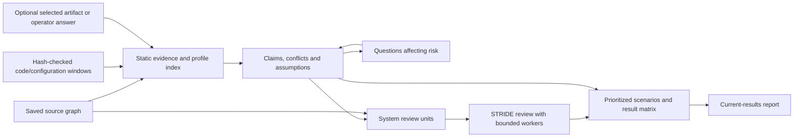

# Deployment context and system-focused static threat modeling

Status: implemented on `codex/deployment-system-review`, pending review and main merge. The implementation is static only and reuses the saved graph. Qualification and remaining limits are recorded in [tests](../testing/deployment-system-review.md).

## Delivered behavior

- The UI defaults to **System threat model**, with explicit deep code-path STRIDE still selectable. Existing API clients default to the prior deep scope unless they request `reviewScope: system`.
- `system-review-units.mjs` groups saved production interfaces and flows by endpoints, protocol and declared control/identity context. Each unit retains member interfaces; grouping never establishes equivalent authorization. Units have at most eight primary records plus six related controls, a 72 KiB base packet limit and explicit split/omission accounting. Source windows use the existing verified retrieval limits.
- `deployment-context.mjs` indexes source declarations into five topics, discovers named configuration profiles, persists optional answers and supplies explicit assumptions to review packets. The UI shows three cards initially, with the remaining cards available on demand. Selecting a profile supplies analysis context; it does not select or prove the effective deployed configuration.
- `deployment-artifacts.mjs` accepts up to eight small JSON/XML/configuration artifacts. It retains recognized declaration names and hashes only, never raw values or executable content. This is evidence of declarations being present, not interpretation of actual effective accounts, grants or policy values.
- Source windows are fetched by saved evidence ID, with existing access-token, containment, hash and redaction checks. Answers are scoped to source fingerprints, and changed source makes the answer stale.
- An answer change invalidates dependent system-review packets and conclusions. Other completed packets remain reusable. Profile/artifact changes conservatively invalidate the system scope. System and deep scope checkpoints are retained separately so switching does not discard prior paid review; unchanged compatible packets make no new calls.
- Current partial results populate the existing priority register and STRIDE matrix. Reports include the active scope and explicit deployment assumptions. No successful model response automatically approves a boundary or establishes deployed actor access.

## Limits in this increment

Claim rows group declarations by component and topic. They do not yet derive a complete policy/ACL interpretation or automatically resolve contradictory deployment profiles. Questions are grouped into five topics, not individually ranked by risk for every component; an operator can keep the conservative assumption or report mixed/unknown when settings differ. Source-linked threat/boundary details remain available in the existing model. Evidence gaps, unresolved destinations and per-window limits remain explicit; system-scope completion is not exhaustive code coverage or deployment verification. Saved source hashes and review contracts still control compatibility; this does not waive source-change invalidation.

The sections below retain the longer-term design contract. Items beyond the delivered behavior above are design targets, not implemented claims.

## Product outcome

A security champion can open the existing portfolio graph and understand the system's external interfaces, internal services/workers/stores, identities, trust transitions and prioritized threat scenarios. Evidence is attached to those conclusions. Missing deployment facts become a small, prioritized set of questions rather than an unexplained wall of pending records.

No supplied documentation or runtime access is required. The system must produce a useful static threat model under explicit assumptions; deployment uncertainty does not prevent analysis. Completion of analysis must never imply approval of an inferred boundary or proof that a configuration is deployed.

The primary threat-model workflow is system flows and controls. Exhaustive source/CWE investigation remains available as a distinct deeper review, with its own coverage and cost. Processing every callable packet is not the definition of a completed architecture threat model.

## User workflow and view

Keep Sources, Source graph, System model, STRIDE and CWE views. Add **Deployment context** within System model, adjacent to Trust boundaries. Reuse the selected repositories and saved graph; do not ask users to enter every inter-repository connection.

The view has four areas:

1. **Configuration profile.** Show the selected profile and its provenance. Default to “Deployment profile not confirmed.” Present discovered alternatives separately instead of merging server, appliance, development and test settings into one deployed system. A user can select a profile for analysis without asserting it is deployed.
2. **Evidence summary.** Show external access, caller identity, service identity, data stores, messaging, transport and privileged resources. Each row gives the conclusion, scope, source link, evidence basis and deployment status. Selecting it opens the exact code/configuration window, hash, graph path and conflicting evidence.
3. **Questions affecting risk.** Show the five highest-impact unanswered questions, with “Why this matters” and links to affected flows/threats. Keep the complete question list accessible and exportable. Deduplicate shared questions across repositories.
4. **Affected conclusions.** Show which scenarios, boundaries and matrix rows depend on a selected fact or assumption. An answer previews the affected review scope before any model call.

Example layout, using illustrative data rather than a claimed deployment:

```text
Deployment context                  Profile: Server installation [not confirmed]

Area             Source evidence                 Deployment status
API caller       Route + authorization handler   Caller network access unknown
Worker identity  Installer service declaration   Installed account unconfirmed
Database         Config key + client binding     Selected database role unknown
TLS              Proxy/certificate declaration   Deployed policy unconfirmed

Questions affecting risk
• Can the administrative API be reached outside the management network?
  Why: changes starting access for the linked privilege-escalation scenarios.
  Affects: API gateway → Admin service; linked threat and boundary references.
  [Answer] [Inspect evidence] [Use an explicit assumption]
```

“Pending” must be replaced or qualified with its actual meaning: no analysis yet, missing evidence, deployment not confirmed, conflicting evidence, or reviewer decision pending. A completed packet and a reviewed boundary are separate facts.

## Use cases

| Use case | Expected behavior |
| --- | --- |
| Existing clones and saved graph, no documentation | Build context from graph references and retrieve unchanged source windows. Make no model call merely to populate the view. |
| Installer declares account/permissions | Show the declaration and its conditions; do not claim effective privileges or installed ACLs. |
| Different configuration profiles conflict | Preserve alternatives and identify selection conditions. Ask which profile is relevant; do not choose silently. |
| Security champion confirms a deployment fact | Record the person, scope, date, basis and optional artifact; label it as a reported deployment fact, not runtime verification. |
| No answer is available | Analyze under a named assumption and expose its effect on threats. Do not invent an answer or block the entire portfolio. |
| One answer/configuration changes | Identify affected conclusions and re-review only dependencies that changed, where dependency completeness is established. |
| Current analysis is partial | Export actual current findings with scope, assumptions and remaining questions; never substitute static checklist entries as results. |

## Evidence acquisition: static only

First use the graph's existing file, interface, control, configuration, installer and relationship records. Retrieve hash-checked, redacted windows from the local clones to support a particular conclusion. A missing parser feature or a changed file is a gap, not evidence of absence.

Relevant sources include application configuration, route/authentication code, service definitions, installer accounts/permissions, proxy/TLS configuration, deployment manifests, messaging destinations, database client configuration and access-control declarations. Supported structured configuration and installer extraction already exists in `engine.mjs`; this is not a claim that every format or effective setting is resolved today.

The first implementation should cover the existing .NET/Windows installer and structured-configuration adapters. Further adapters must declare supported formats and coverage. If the graph contains only a generic declaration, a targeted static read can extract the required fact from the unchanged source. It must not force a portfolio-wide reparse.

An optional sanitized configuration artifact may describe the intended or reported deployed profile. Import only explicitly selected files into protected workspace storage, outside source repositories. Never execute installers/scripts, contact discovered hosts, read a machine's credential store or fetch referenced URLs. Reject path escapes and symlinks, bound input size, redact secrets before persistence/model submission and retain hashes/provenance. Absence of runtime access remains explicit.

No artifact is mandatory. A scoped operator statement is acceptable evidence of what was reported. It is not machine verification of the deployment.

## Evidence and decision model

Store distinct records rather than one overloaded confidence/status field:

- **Evidence reference:** repository/path or approved artifact ID, source generation, hash, line/pointer, extractor and interpretation. Windows are retrieved with existing containment/hash/redaction checks.
- **Configuration profile:** ID, name, selection conditions, component scope, declared/reported status and evidence references. Never conflate different installer targets or environments.
- **Claim:** subject, predicate, redacted value, profile, evidence references, basis (`code`, `configuration`, `installer`, `operator-statement`, `assumption`), assessment (`supported`, `needs-context`, `conflicting`, `stale`).
- **Review decision:** accepted/rejected/unreviewed, reviewer and rationale. Acceptance of a static interpretation does not establish deployed truth.
- **Deployment status:** declared, reported-effective, or not-established. Static analysis never sets runtime-verified.
- **Question:** missing fact, why it affects risk, expected answer type, alternatives, affected claims/flows/scenarios, ownership and answer provenance.
- **Dependency:** claim/profile/evidence to affected review unit, threat, actor access, boundary and matrix row. Preserve ambiguity and incomplete dependency coverage.

Examples: code can support that a route invokes a particular authorization handler. Merely finding an authorization attribute somewhere in the component is not proof it protects that route. A service account declaration supports intended identity; it does not establish effective host rights. Binding to all interfaces does not establish internet reachability.

## Architecture



Proposed component boundaries:

| Component | Responsibility |
| --- | --- |
| `deployment-evidence.mjs` | Deterministic index over saved evidence; targeted adapters; provenance/conflict detection; no LLM or network calls. |
| `deployment-context-store.mjs` | Versioned profiles, claims, answers and dependency records in workspace state; atomic writes, validation and migration. |
| `deployment-questions.mjs` | Group unanswered facts and rank by their effect on exposed interfaces, authority, assets and existing scenarios. No invented numeric confidence. |
| `system-review-units.mjs` | Compose connected flow/control/identity contexts for architecture review and map their coverage explicitly. |
| Existing review coordinator/adapters | Execute bounded parallel requests, validate references, meter tokens, persist results and stop invalid-response spending. |
| System model UI and exporters | Show evidence/deployment/review states separately and link current scenarios to supporting context. |

All new API reads/writes use the existing workspace access token and validation/containment rules. Imported content and source strings remain untrusted data, not instructions. No new agent permission to run code or change deployed systems is introduced.

## Review scope, cost and completion

Construct architecture review units around entry point → service/worker → resource paths and their controls/identities. Group equivalent paths only when their protocol, authority transition, relevant configuration and control evidence match. Keep member interfaces and a coverage manifest. Do not group different authorization policies just because routes have similar names.

Order external interfaces first, follow their internal paths, then review remaining internal authorities and boundaries. Include workers, data stores and messaging. Supporting/test applicability remains explicit. Deep CWE/call-path exploration is separately selectable and must not silently replace system-level STRIDE.

Reuse verified evidence and compatible accepted results. A unit cache key includes its actual evidence/profile dependencies, model/output contract and analysis guidance. Changing a reported deployment fact invalidates affected conclusions, not automatically every repository. The current broad model-revision invalidation must be adapted before promising selective reuse; if dependency completeness is unknown, retain history and conservatively flag the uncertain affected scope. Never relabel an incompatible result current merely to save tokens.

Before paid execution show planned architecture units, scope, gaps, reusable results and measured/estimated usage separately. Do not promise a fixed call count or price without a representative pilot. Evidence-view construction and operator answers make zero LLM calls. The existing limit of four review workers and invalid-response spend guard remain.

An architecture pass finishes when each in-scope review unit has a validated result or an explicit blocked/unresolved disposition. Report reviewed, blocked and deferred counts separately. Blocking gaps prevent an unqualified “complete” claim; open deployment assumptions can yield a completed conditional static assessment. Exhaustive CWE completion remains distinct. A run that stopped on malformed responses is failed/partial, not “review complete with questions.”

The default PDF must include current prioritized threats, readable actor names, affected assets/flows, boundary transitions, evidence, assumptions and actions. Static context is labeled as context. Reviewer questions and evidence gaps belong in a concise section linked to conclusions, not pages of raw IDs. Existing branding/confidentiality and source-code evidence behavior remain.

## Delivery sequence

1. **Evidence/context view:** use existing saved graphs, add the status distinction and linked evidence, profile alternatives and questions. Keep the current STRIDE engine intact. No automatic graph rebuild or paid call.
2. **Scoped answers and artifacts:** add protected persistence, provenance, impact preview and selective re-review dependencies. Qualify restart and unchanged-graph reuse before enabling answers as analysis inputs.
3. **System review units:** introduce an explicit architecture threat-model scope separate from deep source review. Benchmark against the current plan and prove coverage mappings before switching the default. Do not silently mark legacy code packets complete or delete prior findings.

This is a bounded enhancement to the existing application, not a new graph platform or runtime scanner. The already-tested STRIDE recovery release can be installed independently.

## Acceptance criteria

- A saved twelve-repository graph opens and populates context without re-extraction or a model call; all selected repositories remain represented.
- Installer, configuration and code evidence cite exact available source; removed/changed source becomes stale/unavailable. Evidence windows preserve redaction and access protections.
- Fixtures distinguish server/appliance/test profile alternatives, caller identity, worker identity, SQL/messaging resources and a privileged file/ACL declaration.
- Presence of a control in a component does not prove enforcement on every route. Ambiguous call/configuration bindings remain explicit.
- Operator confirmation updates only its scoped claim and dependent conclusions. It does not approve every boundary or create a runtime-verified status.
- Shared unanswered facts create one question with multiple affected references. High-impact questions appear first; the complete list is still accessible.
- Every architecture review unit maps to concrete graph/evidence members; grouping cannot erase a distinct control/identity transition. Deep-review exclusions are disclosed rather than counted complete.
- Accepted unchanged results survive restart and bounded retry. Failed packets retain errors and retry instructions. Changed/uncertain dependencies cannot reuse incompatible results.
- Current returned scenarios populate the matrix and PDF; no-result, failed, stale and partial states stay distinct. Actor/boundary review status remains independent.
- Focused exports reuse the existing small-package limits, exclude secrets/source windows by default and disclose omitted material. No endpoint, installer or target program is executed.

Validation uses deterministic fixtures and provider simulations for execution behavior, plus a separately identified live gateway qualification for model output quality. No simulated finding may be presented as a customer finding.
