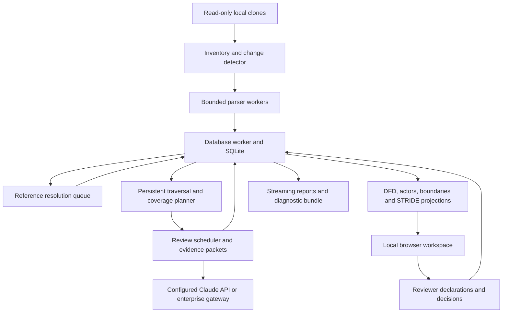

# Disk-backed static graph architecture

Status: target architecture with an initial implementation in static-pilot 0.6.0. The release implements persistent syntax graphs, per-file reuse, generation isolation, disk traversal/packet payloads, paged graph queries and streaming graph exports. The entire target architecture is not yet implemented; see the implementation boundary below. Current behavior and safeguards remain documented in [recursive review and diagnostics](recursive-coverage-observability.md). This specification extends the [system workspace](system-threat-model-workspace.md); it does not replace its evidence, actor, boundary or review contracts.

## 0.6.0 implementation boundary

CLI `serve` and `analyze` default to SQLite on a qualified runtime; `--graph-storage memory` explicitly selects the prior bounded path. Existing snapshots and reviewer records remain compatible and a source rebuild creates the disk graph. Parse results from interrupted builds are reused after rehashing; working generations are rebuilt rather than resumed from an inventory cursor. Graph facts are immutable once published. Current resolution supports unique same-file candidate calls and literal project references; it does not add compiler-level cross-file symbol binding.

The aggregate 100,000-node/200,000-edge limits no longer apply to the SQLite graph. Per-file parser safeguards, 4,096-function traversal limits, 50,000-obligation planner limits, request budgets, worker limits and metadata snapshot limits still apply and remain reported. Interface records, obligations, review summaries and architecture projections remain bounded in memory; they are not fully normalized/paged in this release. This is not an unlimited out-of-core threat-model engine. The default disk guard is 64 GiB of database/WAL and at least 256 MiB free; historical generations are retained rather than automatically deleted.

Graph records and packet payloads use SQLite; the existing atomic snapshot still stores the model metadata, review results and usage. This is a versioned graph-plus-snapshot deployment, not yet the single-database transaction model below. Source excerpts are removed before packet persistence and restored only from explicitly enabled transient context. Traces retain the existing acknowledged append/sync mechanism; the transactional outbox remains future work. Full graph JSON and the graph entry in diagnostics stream; other report metadata still uses bounded buffers.

The [static analysis methodology](static-analysis-methodology.md) restores pinned skill-based guidance, OWASP mapping proposals, structured attack reasoning and optional reviewer risk factors. [Acceptance tests](../testing/disk-graph-and-analysis-quality.md) separate storage scale from analysis quality. The delivery phases below remain the target for retiring the remaining metadata, traversal and resolver constraints.

## Outcome and scope

Analyze a selected portfolio of local repository clones without requiring the entire source graph, coverage plan or export in memory. Preserve enough evidence to explain the DFD, STRIDE scenarios, unresolved references, model expenditure and interrupted work. Run on one Windows or Linux VM with local attached storage. All collection remains static: do not execute target builds, project evaluation scripts, installers, tests, hooks or application services; do not probe deployed endpoints or fetch target dependencies.

Disk capacity replaces the aggregate in-memory graph ceiling, subject to configured storage and execution budgets. This is not unlimited capacity or compiler-level semantic coverage. Per-file parsing safeguards, unsupported-language gaps and unresolved dynamic behavior remain explicit. A graph edge alone does not establish a deployed data flow, actor access or trust boundary.

## Parse once, resolve and review incrementally

1. Enumerate selected repositories and establish a file inventory. Record exclusions, unavailable sources and profile/configuration inputs.
2. Stream each eligible file through hashing, interface extraction and syntax parsing. Commit its bounded output batches to a working graph generation. Do not retain all source text or graph records in JavaScript collections.
3. Query indexed declarations, imports, project references and unresolved references to establish supported candidate bindings. Resolve affected references through a durable work queue. Later discoveries can trigger further queue entries without reparsing unchanged syntax.
4. Publish a generation when every in-scope inventory item has an explicit outcome. Publication can include documented gaps; it must not imply complete semantic coverage. The UI and subsequent review pin that generation.
5. Traverse stored graph relationships to assemble review obligations and evidence packets. Persist the frontier, visited nodes and progress. Model requests receive bounded, coherent subgraphs and relevant architecture declarations.
6. On restart, resume committed work. On refresh, compare file hashes and analysis inputs; reuse compatible syntax and recompute affected relationships, obligations and review packets.

The initial build reads source files and writes the database. Resolution and review then read database pages as needed. Some graph algorithms require several rounds over affected records, but these are not repeated parses of all repositories. Detecting changes can still require rereading unchanged files to hash them. A file is reparsed when its content or syntax-extraction inputs change; changed project ownership or configuration can require resolution to run again even when syntax is reusable.

Clones must remain stationary during a scan. Record repository revisions and working-tree hashes, detect files changing while being read, and retry or mark them unstable. A working-tree inventory is not an atomic filesystem snapshot.

## Components and boundaries

This diagram describes Synthesis components, not the inferred DFD of a target product.

| Component | Responsibility | Existing integration / proposed module |
| --- | --- | --- |
| Workspace coordinator | Jobs, cancellation, generation selection, loopback access and bounded worker communication | Refactor `server.mjs`, `worker.mjs`, `engine.mjs` |
| Inventory and change detector | File identity, content hashes, exclusions, source stability and dependency invalidation | Extend `sources.mjs`; planned `file-inventory.mjs` |
| Parser workers | Static syntax and security-interface extraction; per-file outcomes and bounded output batches | Refactor `source-graph.mjs`, `engine.mjs` |
| Graph storage service | Transactions, indexes, generation visibility, migrations, quotas and backup | Planned `graph-store.mjs`, `graph-store-worker.mjs`, `graph-schema.mjs` |
| Reference resolver | Supported declaration/import/project matching; explicit ambiguous, external and unresolved outcomes | Planned `reference-resolver.mjs` with language adapters |
| Traversal and coverage planner | Persistent frontier and visited sets; obligations, partitions and bridge requests | Refactor `coverage-plan.mjs`, `graph-review.mjs` |
| Model review scheduler | Bounded evidence retrieval, existing provider calls, validation, retries and token accounting | Extend `model-review.mjs`, `graph-review.mjs` |
| Architecture and UI projections | Paged source views, component-level DFD, actor/boundary registers and STRIDE drill-down | Refactor `system-model.mjs`, `server.mjs`, browser views |
| Export and observability | Streaming graph/report exports, durable trace events, recovery and portable diagnostics | Refactor `diagnostics.mjs`, `graph-exports.mjs`, `system-exports.mjs`, `workspace-store.mjs` |

Module names marked planned are implementation boundaries, not files shipped by this specification. Storage interfaces expose operations such as `commitFileBatch`, `publishGeneration`, `pageEdges`, `enqueueReferences`, `claimObligations`, `recordAttempt` and `streamExport`; the browser never submits SQL.

## Storage and process model

Use one embedded SQLite database per workspace, containing graph data, architecture declarations, jobs, review state and usage. Keep source clones, Synthesis installation and workspace storage separate. No separate database server, graph service, container platform or GPU is required for the proposed local deployment.

A dedicated database worker owns writes and checkpoints. Parser workers send bounded batches through a queue with backpressure. Read APIs return bounded pages or iterators; slow consumers cannot accumulate unlimited responses. Synchronous database work must not block the HTTP event loop. Parameterize SQL and enforce foreign-key and generation constraints. Limit parser concurrency according to an explicit memory budget, including WebAssembly memory and process RSS.

The preferred binding is an encapsulated `node:sqlite` adapter, subject to Phase 0 qualification on an exact Node 24 patch for Windows and Linux. Record both Node and embedded SQLite versions in diagnostics. Do not infer API compatibility from the Node major alone or silently change the currently supported Node 22/24 installation requirements. The [Node SQLite documentation](https://nodejs.org/api/sqlite.html) is the API reference; the supported runtime matrix and any minimum-version change must ship with the backend.

Use WAL on local attached storage, with one write/checkpoint owner, bounded busy retries and short read transactions. Require an embedded SQLite version containing the WAL-reset fix (3.51.3 or newer, or a verified fixed backport). Verify the actual bundled engine during qualification. SQLite documents both the [same-host filesystem requirement and WAL version caveat](https://www.sqlite.org/wal.html); workspace databases must not reside on SMB/NFS shares or synchronization folders.

## Persistent records and indexes

| Record group | Essential fields and indexes |
| --- | --- |
| Workspace / generation | Schema and extractor versions, product profile, source inventory digest, state, published pointer, creation/completion times |
| Repository / file version | Repository identity, relative path, content hash, parser/options key, byte count, eligibility and parse outcome; indexed by repository/path and reusable parse key |
| Generation membership | Generation-to-file-version mapping, source-set and resolution revisions; immutable after publication |
| Nodes / interfaces | Stable record identity, file version, kind, name, source offsets, location and evidence references; indexed by owner, kind and symbol lookup key |
| Edges / references | Source and target, relationship kind, resolution status, supporting evidence and profile; forward and reverse adjacency indexes |
| Resolution dependencies | Referenced symbol/configuration/project keys, candidate sets and adapter version; reverse index for invalidation |
| Jobs / traversal | Job state, lease, cursor, frontier, visited keys, predecessor/path references and explicit stop reason |
| Architecture declarations | Components, data stores, actors, access assumptions, boundaries, flows, rationale, reviewer state and source references |
| Coverage / review | Obligation type/status, evidence dependencies, packet hash, partition lineage, batch mapping and validation results |
| Attempts / usage | Attempt ID, provider/deployment, request correlation, timestamps, known input/output/cache usage, failure category and unknown-usage state |
| Trace outbox | Durable event ID, job/attempt correlation and redacted structured payload pending trace-file delivery |

Store reusable file facts separately from generation membership; do not duplicate every unchanged file's graph on each refresh. Resolution facts belong to the relevant generation/context. Stable IDs must include repository identity and source offsets, not just symbol names or line numbers. Persist source hashes and locations, not raw file bodies. Any bounded source excerpt needed for review is read on demand, hash-checked and discarded after use.

## Transactions, restart and invalidation

Per-file batches stage behind an incomplete-file marker; only a completion transaction exposes that file version as reusable. Worker loss discards or resumes staging without presenting a partial file as parsed. A working generation remains separate from the published generation. Publishing updates the active pointer atomically after inventory outcomes are accounted for; readers and reviews stay pinned to their chosen generation until explicitly refreshed.

Persist queue claims with recoverable leases and idempotent work keys. Deduplicate resolver work; cycles terminate through visited/dependency state. Resolve until no new supported facts are found or the configured budget pauses the job. A budget pause records remaining work and a continuation cursor rather than dropping it. A crash releases expired claims without duplicating committed results.

Syntax reuse keys include content hash, language, parser/extractor version and syntax-affecting options. Resolution additionally depends on project ownership, selected profile, configuration declarations and adapter version. New, deleted and renamed declarations invalidate dependent candidate sets; removed symbols must not leave active stale edges. If an adapter cannot determine the affected scope safely, invalidate the enclosing project or portfolio and explain why.

Review reuse keys include packet evidence, paths, relevant actor/boundary/flow declarations, profile, planner/prompt/validation versions, provider and exact model deployment. Preserve successful independent packets when safe. Changed evidence invalidates conclusions and coverage that depended on it while retaining historical token expenditure. Source evidence is immutable within a published generation; stale declarations remain visible for reviewer reconciliation.

Replace the whole-model snapshot as the authoritative store. Migration imports the existing snapshot into a new database, validates counts, references, usage and declarations, then switches only after successful completion. Preserve the original snapshot for rollback; refuse unsupported future schemas. Existing graph truncation cannot be repaired by importing a snapshot: mark inherited gaps and require a source rebuild. Old full-model JSON remains an export format, not an in-memory persistence requirement.

## Resolution quality and threat-model semantics

The first resolver adapters support the existing language set and explicit, statically recoverable relationships. Distinguish exact supported bindings, candidate bindings, ambiguous targets, unavailable external dependencies and unsupported constructs. Add cross-file resolution incrementally with language-specific reference fixtures. Do not claim compiler equivalence, effective deployment configuration or dynamic dispatch resolution merely because a symbol name matches.

The architecture DFD projects processes, stores, external entities and justified flows from evidence plus reviewer declarations. Each flow carries endpoint evidence, protocol/data assumptions, profile, provenance and status. Actor records state access, capabilities and prerequisites. Trust boundaries state the authority or privilege transition, rationale and supporting evidence. Repository boundaries are not automatically trust boundaries. Source-only evidence cannot prove an actor's real-world access or the effectiveness of a deployed control.

STRIDE coverage remains obligation-based. Persist traversal frontier, visited and predecessor records on disk; never reconstruct a global adjacency map or all paths in memory. Record supported representative paths and unresolved alternatives, rather than claiming enumeration of all possible execution paths. Cross-repository relationships receive bridge packets containing both endpoints, relevant path evidence and applicable actor/boundary assumptions. An atomic obligation that cannot fit the model context remains blocked with a reason.

The approved Claude deployment can perform every model-review stage; no second model or provider fallback is required. Disk storage does not enlarge its context window, remove gateway quotas or eliminate model omissions. Keep request/output/context safeguards and adaptive partitioning. Report parsed, resolved, submitted, schema-validated and reviewer-accepted coverage separately; an empty scenario list does not establish safety.

## Provider calls and observability

Commit an attempt record and required pre-dispatch trace before making a network call. Record returned usage before parsing or validating the answer so rejected output still counts. Retain unknown usage when a request times out or the process stops in flight. Exactly-once provider billing cannot be guaranteed across a network/process failure; do not silently redispatch an uncertain attempt. Continuation exposes that uncertainty and records a new attempt if retried.

Use a transactional trace outbox for database changes, drained to existing rotating NDJSON traces with stable event IDs. Recovery can deliver an event again; consumers deduplicate by ID. Record parser starts before dispatch so worker failure retains the last file under analysis. A trace-write failure stops new collection/review dispatch and records the observable failure where storage remains available.

Extend current diagnostics with database/schema/runtime versions, generation IDs, reused/reparsed file counts, resolved/ambiguous/unresolved counts, queue depth, completed/pending obligations, database/WAL size, free space, checkpoint/backup events, per-stage duration and peak RSS. Preserve request-level token totals, retries, failures and unknown expenditure. Traces exclude keys, endpoint URLs, raw prompts, source bodies and provider response prose. Architecture metadata remains confidential.

## UI and exports must also remain bounded

Replace whole-model HTTP payloads and worker messages with summary, page, detail and job-progress responses pinned to a generation. The default DFD remains a readable system/component projection; source detail is retrieved on drill-down. Paginate large registers and matrix rows. A preview must display its scope and omitted counts; it cannot stand in for full export coverage.

Stream graph JSON/NDJSON, coverage, usage and report data from ordered database queries. Replace buffered ZIP creation with a streaming archive writer and backpressure. Compute entry hashes/counts as bytes are emitted; write the manifest after entries complete. A full export must not load the full graph, review plan or archive into memory. Cancelled/failed exports remain clearly incomplete and never replace a completed artifact. For viewers that cannot render a full graph, export the complete machine-readable graph alongside scoped diagrams.

Keep immutable generation records alive for active exports/reviews without holding a long database transaction. Separate trace-retention limits from graph completeness; list every deliberate omission. Preserve portable diagnostics after an early failure, even without a published generation or model response.

## Local VM deployment

The current pilot already runs locally using the [Windows runbook](../runbooks/windows-static-workspace.md). The proposed backend keeps the same deployment shape: a Node process, local browser, readable clones and writable workspace. The SQLite backend ships in 0.6.0; the Windows runbook documents its runtime check and explicit compatibility switch.

| VM item | Proposed arrangement |
| --- | --- |
| Operating system | Supported Windows or Linux release; exact runtime combinations qualified before release |
| Initial qualification machine | 4–8 vCPU, 16 GiB RAM, SSD with approximately 100 GiB free beyond source clone storage |
| Source | Read-only analysis access to a dedicated clone parent, for example `C:/Source/Product` |
| Application | Separate checkout/install, for example `C:/Tools/Synthesis` |
| State | Local attached disk, for example `C:/SynthesisState/Product`; includes database, WAL, traces and temporary exports |
| Browser | Run inside the VM, including through Remote Desktop; retain loopback binding and access-link protection |
| Connectivity | Dependency installation/update access as permitted; outbound HTTPS to the configured provider only when model review is requested |
| Secrets | Existing server-process environment or approved secret injection; never manifests, browser state, database or traces |

These hardware numbers are an engineering qualification starting point, not a measured minimum or a guarantee for twelve arbitrary repositories. Source size, graph density, retained generations, exports, backups and WAL growth determine actual space requirements. Expose measured estimates and free-space checks before starting work. No GPU is needed when inference uses a remote Claude endpoint.

After installation, source graph construction, manual architecture review and local exports can work offline. Claude-backed review requires the approved gateway/API to be reachable. Do not expose the loopback server directly on a VM's LAN address; shared network hosting needs a separate authentication/TLS deployment design.

Use database quotas and free-space thresholds that pause new work before exhaustion. Preserve the last published generation if an ingestion transaction fails. Monitor long readers and checkpoint/WAL growth; serialize maintenance with writes. Back up through the [SQLite backup API](https://www.sqlite.org/backup.html), verify the resulting database and restore it in qualification. Do not copy only a live `.db` file while omitting its active journal state. Retain generations according to explicit policy, never deleting those pinned by active reviews/exports; report cleanup and failures.

## Delivery sequence and release gates

| Phase | Implementation | Gate before proceeding |
| --- | --- | --- |
| 0. Storage contract | Qualify exact runtime/binding; schema, version checks, transactions, backup and worker protocol | Windows/Linux smoke tests; engine contains required fixes; backup/restore, bounded queues and failure behavior verified |
| 1. Persistent collection | Inventory, reusable file versions, batched ingestion, generations and snapshot migration | Same supported facts as existing fixtures; cancelled/crashed collection resumes; no partial file published; no whole-graph memory copy |
| 2. Reference resolution | Declaration indexes, language adapters, dependency invalidation and persistent queue | Cross-file/project fixtures cover exact, ambiguous, missing, cyclic, renamed and deleted symbols; unresolved behavior remains visible |
| 3. Persistent review | Disk traversal, coverage obligations, partition/bridge planner, attempt/usage records | Cross-repository evidence stays together; restart reuses compatible results; budgets pause; uncertain provider attempts are preserved |
| 4. Workspace and exports | Paged views, DFD/actor/boundary/STRIDE projections, streaming exports, trace outbox and recovery | UI/exports agree on generation and counts; no hidden preview truncation; no full model/ZIP buffering |
| 5. Scale qualification | Synthetic scale portfolio and read-only real-source qualification | Acceptance evidence below passes; publish measured capacity, remaining limits and updated Windows instructions |

Do not remove current graph caps merely after adding SQLite. Replace each memory-bound consumer first, then retire the aggregate caps only for the qualified disk-backed path. Keep an explicit compatibility mode during rollout; never silently fall back to a truncated in-memory run.

## Acceptance evidence

- Target a synthetic portfolio of twelve repositories producing at least one million nodes and five million edges. Initial acceptance target: combined application/worker peak RSS no more than 4 GiB on the 16 GiB qualification VM. These are future test targets, not completed measurements. Measure elapsed time, disk/WAL/export sizes and queue pressure; report actual results rather than promising a fixed duration.
- Restart an unchanged scan with zero syntax reparses; separately report bytes reread for change detection. Modify, rename and delete declarations/configuration and verify correct dependency invalidation without stale edges or review reuse.
- Kill parser, database worker and coordinator at transaction and publication boundaries; simulate disk-full, busy-lock and interrupted migration. Verify either the previous published generation or a consistent resumable working generation survives.
- Interrupt before dispatch, during a provider call, after usage capture and during validation. Verify persisted attempt status, no silent duplicate dispatch, correct known totals and explicitly unknown expenditure.
- Exercise cycles, dense graphs, ambiguous bindings, unsupported files, oversized atomic packets and exhausted budgets. Assert visible gaps/pending work and bounded memory, not false completion.
- Compare complete streamed export counts and hashes against stored generations; test cancellation, malformed trailing traces, archive integrity, source/secret redaction and consistent backup restoration.
- Browser tests cover source selection, progress/resume, coverage drill-down, overall DFD, actor and boundary evidence, STRIDE cells, usage and export. Verify that preview limits do not alter complete model counts.
- Re-run static qualification against the authorized `open-autofix` checkout without executing its code. Record commit/working-tree state, all coverage denominators, performance and limitations separately from synthetic results. Customer source/gateway qualification remains an environment-specific acceptance activity; direct-provider tests do not qualify that gateway.

The release report must identify implemented phases, tested platforms, measured limits and remaining semantic gaps. Only limits explicitly retired by the 0.6.0 implementation boundary are removed. The remaining gates and constraints must not be described as completed.

Diagnostic ZIP output is limited to 2 GiB. An oversized export fails explicitly; use the separate full source-graph JSON export for larger graphs and retain the workspace and traces.

## 0.7.0 connection and code review extension

The published disk generation now supplies static connection facts to automatic DFD correlation. Source and interaction packets also support model-assisted CWE code review. See [Connected DFD and CWE source review](connected-dfd-cwe-review.md) for components, evidence semantics, limits and persistence behavior.
