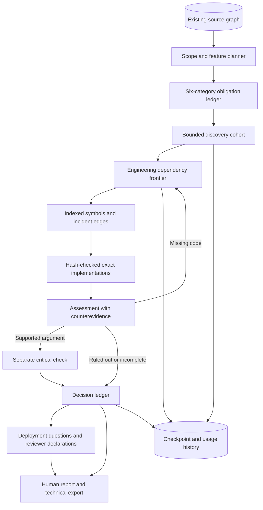
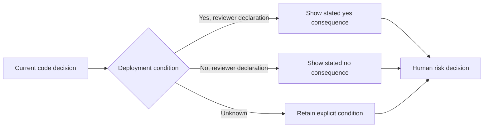

# Feature threat review: engineering design

Companion: [product contract](../product/feature-threat-review.md). Static only. Existing graph is the authoritative source index. Repository source and model output are untrusted data, never executable instructions.

## Architecture

Reuse `systemReviewPlan`, `enrichGraphModel`, `InvestigationSource`, `reviewThreatScenarios`, the review pool, workspace persistence and current citation validators. Do not add an independent graph store or a second status authority. Feature organization is a projection of saved scope/units and validated results. Existing deep review, CWE and SD Elements obligations remain intact.

## Scope and case identity

Repository scope gains an explicit `reviewDepth`: `all-subjects` (backward-compatible default) or `security-features`. Security features select source-derived network/data/worker/control/configuration interfaces; parsed helper definitions and imports remain supporting traversal context. The preview enumerates deferred subject count and full file inventory. It never calls the reduced mode “whole repository complete.”

A feature groups primary operations by repository, component and source file for navigation. A case remains an operation/category obligation. Different routes, actors, object rules or registration paths must not share conclusions merely because they occupy the same file. Groups can split for packet budgets, but category coverage still accounts for each member. Feature names and boundaries are candidates until supported; no model-generated name becomes a verified connection.

Saved scope identity includes mode, primary repositories and profile. Packet identity includes actual context and response contract. Source revision, graph generation, policy/schema version and cited file hashes constrain reuse. Opaque IDs remain in persisted/technical data; the main report uses readable titles and stable threat references.

## Execution policy

Discovery runs in small cohorts (up to the existing four-worker provider limit). Engineering assessment of a cohort's returned hypotheses runs before the next discovery cohort. Category-level missing controls receive at most two evidence reassessments per batch, retaining previous paid results; failure restores the prior valid result. Function/method/type definitions outrank repeated call sites. Calls are not counted as implementation definitions.

Within engineering assessment, explicit missing implementations and pending critical checks take precedence over fresh hypotheses. Independent paths continue after bounded incomplete results. Provider authentication/configuration failures stop dispatch, preserving checkpoints.

The bounded request budget covers both discovery and engineering requests. Continuous mode can continue across cohorts, but still honors cancellation, per-case limits, failure guards, provider recovery and hard resource limits. Token targets remain advisory when labeled advisory. A case exhausting its evidence budget is incomplete, not secure. Model responses that fail schema or reference validation cannot clear coverage.

Use the existing pool for discovery. Engineering first uses a single writer and existing sequential assessment loop to preserve atomic checkpoint semantics; four discovery workers do not imply four independently writing validation workers. Parallel engineering can follow only with leases and a serialized merge keyed by case/context, and is not claimed until tested.

## Evidence retrieval and packing

1. Resolve exact symbols in explicit missing-code obligations and follow-up references.
2. Retrieve source seeds and exact implementations before generic startup or neighboring candidates.
3. Follow registration, inherited/global controls and concrete dependencies. Search across supporting repositories, ranking same project/production first without converting rank to applicability proof.
4. If the symbol index has no exact definition, use a bounded, read-only text search of indexed source files. Enforce repository selection, containment, no symlinks, size limit, file identity and saved hash. Search failures and truncation are explicit. Text matches are candidates, not bindings.
5. Read whole indexed functions where they fit. For large functions, retain precise windows and an explicit incomplete-function marker. Never let a partial function silently imply full control review.
6. Pack required dependencies first, coalesce overlapping windows and reserve room for the entry/sensitive operation. Retain prior citations and exact missing dependencies across rounds. Do not resend broad source context merely to maintain conversational history.

Verified file reads may be reused within one packet construction. Re-read/recheck between investigations or source revisions. Do not cache a negative lookup as proof of absent enforcement. Future shared control assessments require source hash, registration path, profile, framework/version and applicability keys, plus invalidation tests; file name alone is never sufficient.

## Decision and deployment contracts

Code obligations remain `entry`, `sensitive-operation`, `path-binding`, `applicable-controls`. Each established/blocked obligation needs exact submitted source citations. Positive code decisions require the separate critical check. Missing implementation cannot be converted into a deployment condition. A conditional write concern does not establish credential theft without the additional path.

Question identity includes the threat and current assessment context, full question/consequences and deployment profile. Answer records contain yes/no/unknown, named reviewer, rationale, profile and timestamp. Source/profile/question changes invalidate applicability, retaining history. Answers never mutate `aiReview` category coverage or automated source assessments. The UI explicitly calls them reviewer declarations.

No single answer automatically rules out all paths. Private networking does not exclude authenticated misuse or compromised peers. Default/inferred boundaries are analysis assumptions; they are never approved by completing a model call.

## Reports and coverage

Default report: compact scope receipt, feature/category decisions, supported threats with code/control evidence, ruled-out paths, top deployment decisions, named DFD and residual work counts. The complete register and code backlog move to an explicit technical-report option. Omitted counts and retrieval directions are mandatory. Partial exports use saved checkpoints, not in-flight work.

Feature/category state distinguishes not reviewed, partial, incomplete code, decision available and stale. Category conclusions alone do not independently validate every emitted threat. Counts of category outcomes, unique scenarios and request packets must not be interchanged. Existing stale provenance checks apply before projecting any current decision.

## Safety and failure handling

Source-only execution: no target imports, scripts, builds, tests, network probes or model tool execution. The model gateway is the only authorized model network destination. Source snippets remain opt-in and redacted. Model strings and reviewer answers are bounded, redacted and HTML-escaped. Mutating APIs require local access token, current revision and idle workspace. Persistence is atomic through the existing workspace store. Windows SQLite handles close before cleanup.

Do not silently retry authentication failures. Distinguish provider HTTP, invalid structured response, source retrieval and graph-budget failures. Save usage even on invalid output. A cancellation stops new work and retains valid earlier checkpoints. Resume does not repeat compatible conclusive cases; changed source or applicability reopens only affected decisions where identity permits safe reuse.

## Verification and rollout gates

1. Unit/integration fixtures: all six categories, defined/unresolved crossings, function over-window, absent symbol index, cross-repository implementation, duplicate symbols, changed files, private keys and symlinks, unanswered/stale reviewer declarations.
2. Cohort test: discovery produces a missing-control hypothesis; exact follow-up retrieves the control; a critical check narrows or settles the finding before the next cohort. Bounded combined request budget and no duplicate resume calls.
3. Saved open-autofix graph: run the real source retrieval and report projection without rebuilding; run representative live assessments if approved credentials are available. Record fixture versus live results separately.
4. JCI: reproduce the `ApplyAuthorization` / `TryRevokeAccess` / `SolutionAuthorizationHandler` investigation against the Windows graph. Local fixtures prove mechanics, not JCI applicability.
5. Report review: short default report with all supported findings retained, complete technical export, correct category counts, no raw UUIDs in executive text, precise gaps.
6. Before release: required package tests and browser checks; record actual elapsed time/tokens. No estimated speedup presented as measured savings. Keep existing workspace format backward-compatible and provide Windows backup/update/resume commands.

## Explicit follow-on work

Large-scale graph partitioning, cross-case proven-control caching, independently configured validation models, per-case multi-worker leases and JCI-ground-truth competitive benchmarking require separate qualification. The first implementation must not advertise them as working. Architecture supports them without making completion depend on a wholesale graph rewrite.

## Decision contract and compatibility

The native provider response uses five groups: assessment, caseDetails,
evidenceReview, remediation and engineering. Input/sink references are derived
from the locally validated trace rather than duplicated nullable wire objects.
Condition bindings reference established code obligations and reuse their exact
validated citations. These changes reduce native grammar complexity without
removing local source-window, enum, completeness or redaction validation. CWE's
response contract is unchanged.

The saved assessment remains in the existing canonical shape. New engineering
records have version 2, conditions and a consistency result. Unresolved consistency
cannot publish a supported or ruled-out conclusion. Critical checking receives
prior conditions and remediation as hypotheses, alongside freshly verified source.

Question IDs retain the previous algorithm for legacy questions. Version 2 IDs
also include the bound condition, so changing its polarity or scope invalidates
its answer. Answers never mutate the code assessment. An explicit one-case
condition recheck archives the old report and reuses the existing challenge path;
ordinary resume retains compatible conclusions.

`decisionPath` and operation counters are read-only projections. They do not alter
coverage, source graphs, actor declarations or boundary states. Guide profiles are
bounded JSON declarations (32 KiB; eight profiles; twelve cited statements each),
with explicit source/version and repository scope. They do not fetch URLs or run
commands. Only relevant packets receive guide context; affected results require
review when context changes. Raw evidence and technical exports remain available.
