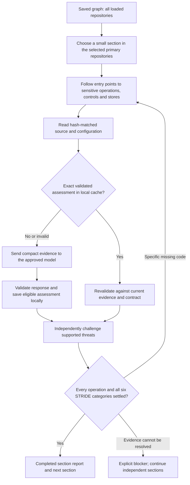

# Local assessment reuse and compact evidence

JCI does not require or use provider prompt caching. Synthesis caches validated assessments in its own workspace and sends a lossless compact representation of source evidence for new automatic-section requests.

## Investigation flow

The independent challenge has its own prompt and cache key. A cached initial assessment cannot stand in for that challenge. An unresolved result is not cached as a conclusive assessment. Existing saved completed sections are still skipped before this layer is consulted.

## Cache boundary

The cache is `review-cache.sqlite` beside `snapshot.json` and `graph.sqlite`, outside source repositories. It is per workspace, bounded to 1,000 responses and 64 MiB of logical payload, with at most 1 MiB per item. Least recently used entries are evicted. It can be deleted with Synthesis stopped; deletion affects performance, not evidence or saved reports. Diagnostic and graph exports do not include this database.

Keys bind the complete original evidence packet, workspace analysis context, provider/model endpoint, API version, structured-output mode, response schema, effective review instructions and cache/transport version. Source hashing occurs before lookup. Current validation runs again on every hit; changed validator output or an invalid response rejects the entry. The key contains no API credential.

The database stores eligible validated provider responses and integrity hashes. It does not store request packets, source-file copies or keys. Response prose can still describe confidential code and architecture; protect it as workspace data. String redaction runs before persistence. If redaction changes the validated decision, that response is not cached. SQLite handles close before worker exit, including cancellation and failures.

No network or runtime reachability is inferred from a cache hit. Deployment assumptions remain explicit and are included in the context. Identical helper names, matching routes in other repositories, and similar source are insufficient for reuse. Shared-control conclusions across different routes require a separate applicability proof and are not implemented by this exact-match cache.

## Lossless evidence transport

Records with the same repository, path and source hash can share numbered text segments. Each record keeps its original ID, metadata and allowed citation range. All supplied lines remain available; disjoint windows stay disjoint. Conflicting source representations remain untouched. The wire instruction forbids citing the shared block ID or extending the record's source range. Validators use the original packet, not the compressed representation. Round-trip tests check exact equality, including gaps and metadata. Compaction is skipped unless net savings, including the extra instruction, reach five percent.

## Accounting and completion

Only actual provider dispatches enter the token ledger. Cached assessments are shown separately as local reuse; they do not replay historic token charges. Reports expose duplicate input bytes avoided, which are not represented as measured token savings. Provider error responses, invalid assessments and unresolved evidence do not become reusable clearance.

The existing completion rules are unchanged: every named operation must have all six cited category decisions; supported threats require an independent challenge and established entry, sensitive operation, path binding and applicable controls. A cost limit or cache miss cannot relabel an incomplete section as complete.

## Performance limits

Local caching avoids compatible repeat requests. It cannot make a stateless gateway remember prior prompts and does not eliminate a cold assessment of new code. Compaction reduces duplicate transport, not the number of independent investigations. Fewer cold calls will require measured batching of related cases and evidence-backed shared-control applicability; neither should be claimed as delivered by this change.

First-run batching is separately specified in [section threat batching](section-threat-batching.md). It shares verified supporting source while retaining per-case primary anchors and applicability checks; exact-request caching alone does not provide this behavior.
