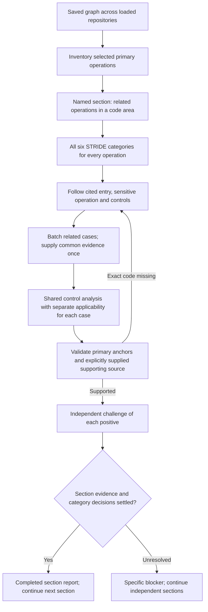

# First-run section threat batching

## Product contract

A saved graph supplies small named sections. Synthesis inventories the selected primary operations, reviews every operation across all six STRIDE categories, then investigates the returned scenarios. Supporting repositories remain available for cited bindings and controls. Neither batching nor an external-actor display filter changes the primary review scope.

A section is a completion unit. A threat batch is an execution unit within that section. The planner defaults to three operations per section (maximum four), grouped by repository, component, source file, route family, read/write behavior and source scope. Those groups are not declarations of trust boundaries. There is no JCI repository name hardcoding.

## First-run sharing

By default, up to three related cases share one model request (explicit maximum four) when they share exact source records and their combined transmitted packet fits 160,000 bytes after lossless source-text packing. A larger or unrelated group is split, never silently dropped. Identical source and context are supplied once; each case retains its primary-operation anchors, missing evidence and deployment conditions. The batch explicitly makes the already hash-checked source from related cases available as supporting context; it never treats another operation as the current entry point. The existing lossless source-window transport additionally pools overlapping lines. Batch admission uses that transmitted size, so repeated source text does not force a needless split. When packing is disabled, the original byte limit applies unchanged.

The model analyzes a shared control once and returns a separate applicability decision for each case: enforces, ineffective, not applicable, or unresolved. Each enforcing or ineffective use must cite that case's entry and path binding, and the control must appear in its applicable-controls evidence. A control that is not applicable instead cites the case's registration or control evidence showing why the helper is excluded; it must not pretend that an unused helper is on the path. Entry and path obligations, plus the input trace, must retain a citation to that case's primary-operation window. Supporting source is retained in the evidence record and rechecked on resume. Every case still receives the original complete engineering assessment and validator. A common helper name does not establish enforcement.

All supported cases receive a separate challenge request. The challenge assesses source and applicability again; a shared initial conclusion is a hypothesis, not proof. A failed case cannot discard successful siblings. Follow-up retrieval targets only unresolved cases. Invalid batches shrink on bounded retries. Provider authorization or transport failures stop dispatch and preserve saved progress.

## Provider contract

Native schema compilation rejected a deeply nested array of complete assessment schemas during qualification. The batch envelope therefore uses a bounded `assessmentJson` string per case. This contains the complete original assessment object, with its schema supplied in the field description. Synthesis parses it and runs the same full local schema, enum, evidence, consistency and condition validation as the serial path. The outer native schema is small. Invalid JSON or a missing case becomes a visible failed case; it never counts as coverage. No schema checks are removed to accommodate provider limits.

This is a transport choice, not a fallback to unvalidated prose. The normal serial pathway remains available and unchanged. Automatic sections opt into batching; manual STRIDE and CWE behavior is unchanged.

## Completion and accounting

Six-category completion is still evaluated per operation. Every supported threat needs established entry, sensitive operation, path binding and applicable-control obligations, a consistent conditional conclusion and an independent challenge. Ruled-out cases need cited blocking evidence. Missing implementation stays incomplete; runtime exposure is never inferred from static code.

One provider dispatch is charged once even if it assesses four cases. Each case retains the shared attempt ID; per-case counts are not token charges. Cached replay records no provider attempt. All retries and errors remain metered, including unknown usage. Byte reductions are not advertised as token savings. Cold qualification disables the local cache in both paths.

## Reader contract

The default report shows the decision, impact, actor/access, decisive control, every required deployment condition, developer action, validation step and source citations. The full path, opposing evidence and review rationale follow in an appendix retained in HTML and PDF. All six category decisions stay in the matrix; their full supporting narratives remain in the appendix. No saved conclusion is rewritten by an extra model call, and no sentence or prerequisite is truncated for layout. The technical export retains detailed records.

## Visual

Local exact-request caching complements this first-run sharing. It does not make the gateway remember earlier prompts. A new route cannot inherit an assessment based on similarity alone.

## Competitive claim boundary

Microsoft documents MDASH source graphs, attack-surface/threat-model preparation, specialized auditor agents, independent debate, LSP-based validation and runtime context. Synthesis must not claim those capabilities are unique. The proposed JCI differentiation is an explicit system threat-model review package with section completion, all-six-category decisions, actor/boundary assumptions and deployment-specific actions. Accuracy, speed or cost superiority requires a same-scope benchmark; none against MDASH has been performed.

Sources checked 2026-11-28: [Microsoft overview](https://learn.microsoft.com/en-us/security-exposure-management/ai-code-security-overview), [Microsoft FAQ](https://learn.microsoft.com/en-us/security-exposure-management/codename-mdash-faq).

## Source ownership qualification

Live qualification exposed a distinction that a simple shared source pool missed: related cases can retrieve different windows of the same helper. Restricting all citations to the original per-case windows rejects legitimate supporting evidence; allowing any source to replace the entry lets cases bleed into one another. The final contract makes additional supporting windows explicit while mechanically requiring the case's own entry and path anchors. The original complete validator still checks each exact range and hash; independent challenge still checks semantic applicability. Missing-source gaps are not silently cleared by pooling.

## Cold engineering qualification

The matched open-autofix comparison refreshed the same four engineering assessments and positive challenges, with local cache disabled and zero provider-reported cache tokens. Serial used 9 requests, 255,276 tokens and 721.7 seconds. Three-case grouping used 6 requests, 219,540 tokens and 602.4 seconds: 14.0% fewer tokens and 16.5% less time. A separate four-case grouping used 7 requests, 258,857 tokens and 690.2 seconds: 1.4% more tokens and 4.4% less time. All attempts and validation follow-ups are included. These are single matched runs, not a universal speed guarantee. The default is three because larger batches did not improve this measured result.

Both batching runs settled all four cases with independent challenges and preserved the existing section's six-category decisions and other four assessments. They are engineering-stage refresh measurements, not a fresh whole-section discovery benchmark or a prediction for JCI's gateway. The graph was unchanged.
