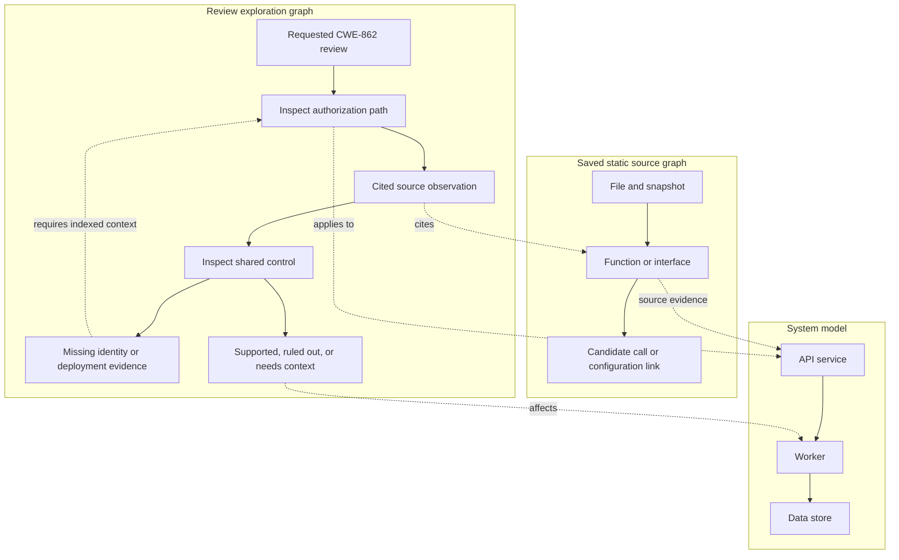

# Static exploration graph: ARTEX comparison and implementation

Status: implemented review increment on `feat/static-security-intelligence`, not a main release. The original ARTEX comparison below describes the design rationale. The implementation uses an original SVG canvas and local SQLite; it does not copy ARTEX source or runtime tools.

## Implemented increment

- `ExplorationStore` persists typed nodes, links, object references and append-only record transitions in `exploration.sqlite`. Source revisions remain independently queryable. Existing review reports are imported on opening the workspace; historical details never recorded by older versions cannot be reconstructed.
- All 29 requested CWE targets per selected repository are visible, including the four additional-evidence targets. Six STRIDE category obligations per repository remain separate. Source packets, findings, assessment rounds, cited windows, controls, counterevidence and gaps retain their relationships.
- The authenticated API offers child expansion, recursive ancestor lineage, repository/type filters, snapshot selection, details and transition counts. Responses contain up to 100 records, with totals and remaining counts. Detail history shows the latest 20 transitions and the total; the SQLite store retains older transitions. Querying saved records does not rebuild the source graph.
- The canvas provides directional layout, pan/zoom/fit, minimap, branch navigation, expandable CWE groups, source details and links with the DFD. Positions are deterministic for unchanged views; polling does not reset the canvas. This is review lineage, not an executable attack graph.
- Source retrieval accepts only current saved assessment references, verifies containment and source hashes, and returns redacted windows. It does not execute target code. Selected JSON/SVG downloads enforce a 3 MiB client-side cap; focused source packages retain their existing independent limits.
- `InvestigationFrontier` makes saved investigation steps and dependency edges the work scheduler. Repository enumeration, code windows, indexed search, relationship traversal, evidence retrieval, STRIDE packets and candidate assessment are durable task kinds. Missing evidence returned by a review creates dependencies; their results return to the originating review. Repository service order accounts for previous model calls, so one repository cannot consume the whole action while others have ready work.
- `InvestigationSource` reads the existing disk graph with paginated node and incident-edge queries. Model requests are limited to program-validated indexed searches and supplied neighbor IDs. No shell, network probes, arbitrary filesystem paths or target execution are available. Static symbol matches and graph edges remain hypotheses.
- The action has separate request, token-reservation, graph-step, depth and wall-time budgets. A stopped frontier resumes from SQLite. Failed or interrupted steps require an explicit retry selection; at most three model attempts per failed step. Completed results and provider usage are journaled independently of report projection. Increasing depth can reopen depth-limited paths.
- Every selected repository retains the 25 code-review targets plus four additional-evidence targets. Additional unmapped security concerns remain additive. Source windows are read lazily with hashes checked; continuation verifies the unchanged inventory but does not rerun extraction. A source, declaration, provider, prompt or target-profile change creates a separate investigation scope.
- The mission freezes its starting architectural context to avoid invalidating its own results as STRIDE produces new hypotheses. Explicit declaration/source changes require a new scope. Existing standalone review actions remain available but their packet plans are separate from the graph-driven investigation.
- Optional Semgrep baseline work uses the existing read-only staging adapter. Semgrep parses source itself; it does not consume Synthesis's graph as an AST. Focused model-requested Semgrep jobs are not implemented in this increment. Scanner findings can seed graph-driven evidence assessment.

## Remaining boundaries

The scheduler can investigate only what the parsers/index expose or what verified source windows reveal. It is not compiler-level whole-program resolution. Search is literal indexed-name/path retrieval; ambiguous matches do not prove identity. Source packets retain 80-line windows, up to 16 windows and 60 KB of code context, 94 KB total packets, and up to 128 catalog nodes. Discovery packets cover at most four repositories at once; an investigation can span all selected repositories over many packets. Assessment packets can include evidence from all twelve within the same byte/window limits. Omissions and unresolved evidence remain gaps.

A token reservation estimates a conservative request allowance before sending; actual provider-reported usage is retained separately. Unknown usage is charged at the reservation for scheduling. This is not a billing guarantee. One call can overrun a wall-time boundary during cancellation; its outcome is retained as unknown/interrupted where necessary. Source verification requires disk reads but no parser rebuild. SQLite storage is durable, not unlimited; existing graph/parser/planner resource limits remain.

Coverage counts completed inspections separately from pending follow-ups, failures and evidence gaps. A completed model response is not a verified vulnerability. Deployment, identity, business-process and runtime facts unavailable from source stay unresolved. Automatic reconstruction of every alternative route, arbitrary context inheritance and complete vulnerability detection are not promised.

## What ARTEX actually implements

Reviewed the local ARTEX checkout at `d89cf781b790ec9a1d071bee7e79de489ed05252`, its README and screenshots, the graph components, graph APIs, lineage queries, anchors, coverage ledger and planner overview. The upstream README was also fetched for comparison. This was source inspection, not a running ARTEX penetration test.

ARTEX's two graphs are **asset inventory** and **task exploration**, not an AST/code graph and a findings list:

- Its shared asset graph models discovered domains, IP addresses, services, applications and endpoints. Program-controlled identities and containment organize the observations.
- Its task exploration graph records goals, investigation intents, facts, findings, hints and digests. Typed edges preserve what prompted an investigation and what it produced.
- Explicit anchors join exploration nodes to concrete assets. This lets an asset expose its associated investigations, observations and findings.
- The exploration canvas uses React Flow, directional layering, typed/color-coded nodes and edges, drag/zoom controls, a minimap and a detail drawer. Existing node positions survive refreshes; the task tab avoids rebuilding when the polled data is unchanged.
- A finding-specific API uses a recursive ancestor query to return how that finding was reached. The same canvas renders that subgraph.
- Completed history can be folded into active digest nodes. Member identifiers and underlying records remain available; the drawer can navigate to a folded member. The planner also has digest expansion and individual-node retrieval tools.
- A separate G6 force-directed asset-coverage view supports grouped expansion and asset details. Its coverage ledger additionally records risk areas, negative results, evidence and follow-up gaps. No finding is not equivalent to no issue.
- The planner observes graph state and queues further work. Workers return observations and findings that update the graphs. In ARTEX this includes real tool execution and traffic evidence; that execution mechanism is outside Synthesis's static-only contract.

These are implemented features, not just diagrams in the README. They also have limits: the task graph API requests up to 2,000 nodes and 5,000 edges per current/direct-source store. A node or edge label is not independent proof: for example, the fact confidence consumed by the goal-completion gate is declared by the recording agent. Synthesis must keep its own evidence and coverage rules.

## Baseline comparison used for this increment

| ARTEX capability | Synthesis before this increment | Design improvement |
|---|---|---|
| Shared asset graph | Source-derived system model: components, resources, interfaces, flows, actors and boundaries | Snapshot-scoped anchors between every review step and these objects |
| Per-task exploration graph | Candidate assessment entries, per-round history, packet/response hashes and trace events | Persist typed review nodes and edges, rather than treating the ledger as a visual graph already |
| Finding lineage | Latest ordered source trace, cited controls, counterevidence and gaps | Queryable root-to-finding history with explicit derivation and contradictory evidence |
| Interactive exploration canvas | Source graph search, DFD inspector and expandable investigation records | A review canvas with stable positions, minimap, branch navigation and node details |
| Asset-coverage graph and risk ledger | Requested-CWE coverage, repository coverage and STRIDE review status | Component/CWE/STRIDE overlays that link directly to review steps and outstanding evidence |
| Digest folding and expansion | Bounded packets and explicit omissions | Reversible visual summaries with exact member IDs and on-demand retrieval |
| Cross-task context | Saved workspace, source hashes and compatible assessment reuse | Explicit read-only links to previous review runs with stale-source handling |
| Runtime tools and recorded exchanges | Static parsers, Semgrep, approved model calls and hash-checked source windows | No runtime equivalent: do not introduce target execution, traffic capture or probes |

Synthesis also has a lower-level source graph that ARTEX's asset/exploration pair does not replace. Preserve all three concerns: source structure, system architecture and review history.

## Review graph design

This diagram is the proposed static workflow, not an assertion that any particular repository has a vulnerability or that a source edge proves runtime reachability.

Persist `review_goal`, `review_step`, `source_observation`, `control_assessment`, `finding`, `gap` and `summary` records. Relationships include `spawns`, `derived_from`, `produces`, `supports`, `contradicts`, `needs_evidence` and `summarizes`. Avoid using a generic `proves` relationship to imply exploitability from static source.

Each node carries its workspace/run, source revision, original requested target ID where applicable, execution status, evidence assessment, source basis, provider/prompt identity, usage references and relevant source hashes. Execution state and security judgment are separate: a completed model call can still produce an unresolved or rejected assessment.

Anchors refer to existing component, interface, flow, actor, boundary, source-record and finding IDs. Do not merge two assets because their labels look alike. A source file is not a trust boundary. Retain inferred and reviewed boundary states.

Use separate SQLite tables for exploration nodes, edges, anchors and append-only transitions alongside the existing source graph. Opening a compatible saved source graph must not rebuild it. Source/context changes mark dependent review records stale; they do not rewrite historical evidence into the new snapshot.

## Requested CWE coverage stays mandatory

Every required code-review target becomes a visible review obligation, carrying its original target ID and requested CWE mapping. Each selected repository retains pending, reviewed, needs-context or explicit applicability evidence. Additional concerns without a defensible CWE mapping are separate obligations; they never satisfy a requested CWE check.

The coverage view must distinguish a visited component, a completed request, a reviewed CWE target and a supported finding. A failed request, exhausted budget, missing caller, parser gap or absence of findings must never turn coverage green. Targets that require evidence beyond code remain visibly unresolved.

## Interface design

1. **System DFD:** applications, internal services, workers, brokers and data stores; actor and trust-boundary overlays. Selecting an object shows its review obligations and findings.
2. **Review graph:** a left-to-right history of the selected CWE, component or finding. Show branches, explicit contradictions, failures, pending work and source-supported conclusions. Selecting a node opens its evidence, assumptions, controls, usage and missing context.
3. **Source evidence:** the relevant source neighborhood and exact code windows, reached from the selected review node. Do not fill the initial canvas with every file or call site.

Provide zoom, pan, fit, minimap, stable positions and scope breadcrumbs. Group by repository, component, CWE or review phase. Folded groups show counts and exact members; missing/unloaded nodes show explicit counts. A summary is a navigation aid, never substitute proof.

The review canvas represents investigation lineage. The DFD represents data movement. Keep their edge semantics distinct and connect the views through anchors.

## Implementation sequence and acceptance

1. Project existing candidates, packets, assessment history and failures into a versioned graph schema; retain current exports and requested-CWE reports.
2. Add snapshot-scoped anchor and lineage queries with pagination, total counts and explicit omissions. Preserve history and stale evidence across restart.
3. Build the interactive review canvas and bidirectional DFD/finding/evidence navigation. Use directional layout for investigation lineage; a force layout is not automatically appropriate for the system DFD.
4. Add reversible grouping, coverage overlays and compact export of the selected lineage plus relevant source/control windows. Retain the existing few-megabyte transfer cap and omission manifest.
5. Verify twelve-repository fixtures, changed-source invalidation, invalid-citation rejection, required-CWE preservation, pending/failed coverage, restart, stable selection/layout and bounded exports. Validate the UI on saved open-autofix results without executing its code.

The same approved Claude deployment can handle discovery and assessment roles. This does not require multiple providers, a target runtime, PostgreSQL, or a new VM service. Do not copy ARTEX's network probing, shell-tool or traffic-replay workflow into this static review mode.

## Implementation evidence reviewed

- [README and dual-graph design](https://github.com/BaaRai/ARTEX/blob/d89cf781b790ec9a1d071bee7e79de489ed05252/README.md)
- [Exploration canvas, digest folding and detail drawer](https://github.com/BaaRai/ARTEX/blob/d89cf781b790ec9a1d071bee7e79de489ed05252/web/src/components/exploration-graph.tsx)
- [Graph API limits and endpoints](https://github.com/BaaRai/ARTEX/blob/d89cf781b790ec9a1d071bee7e79de489ed05252/server/server.go)
- [Anchors and finding-lineage query](https://github.com/BaaRai/ARTEX/blob/d89cf781b790ec9a1d071bee7e79de489ed05252/db/exploration.go)
- [Coverage outcomes and missing-evidence rules](https://github.com/BaaRai/ARTEX/blob/d89cf781b790ec9a1d071bee7e79de489ed05252/db/coverage_ledger.go)
- [Planner graph overview and goal-completion gates](https://github.com/BaaRai/ARTEX/blob/d89cf781b790ec9a1d071bee7e79de489ed05252/agent/tools.go)
- [Digest expansion and read-only inherited context](https://github.com/BaaRai/ARTEX/blob/d89cf781b790ec9a1d071bee7e79de489ed05252/agent/tools_digest.go)
