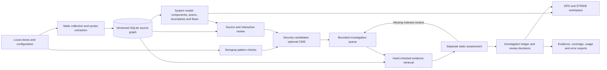

# Static security intelligence and investigation architecture

Status: implemented candidate-investigation increment; see the verification specification and explicit limits below. No production-control changes or active testing are authorized by this feature.

## Product contract

A security issue is not defined by a CWE identifier. Keep source observations, threat scenarios, potential weaknesses, control gaps, excessive authority, attack paths and recovery gaps distinct. CWE is an optional classification of a supported weakness; STRIDE classifies threat scenarios. Neither taxonomy is proof or a completeness checklist. A finding without a suitable CWE remains visible and exportable.

Requested-CWE scanning remains mandatory for the selected weakness profile: Semgrep checks, model assessments for every supplied code-review target, explicit target IDs, mappings and per-target coverage are preserved. An unmapped concern never replaces a requested CWE assessment or counts as satisfying that target. A result without the required target assessments is rejected.

Security champions need to answer: who can act, with what initial authority, through which entry and transformations, against which asset, across which trust boundary, subject to which controls, with what residual exposure? External attackers, malicious insiders, compromised workloads and authorized agents exceeding an intended task are different actor scenarios. Do not assume that a product contains agents or a specific attack path without source evidence.

## Architecture

1. **Source graph:** existing persistent syntax graph, configuration connections, source hashes and coverage. It is not a compiler-resolved taint graph. Saved graphs remain reusable; investigation reads selected files without rebuilding or running target code.
2. **System model:** existing source-backed architecture and reviewer declarations. A bounded shared context carries actors, boundaries, components, controls, flows and source snapshots into both source review and investigation. Source observations, inferred candidates and reviewer decisions retain their basis. Context omissions are explicit.
3. **Candidate discovery:** Semgrep plus approved model source review. Preserve the requested weakness profile and additional findings. Model candidates may use `cwe: null` with `control-gap`, `excessive-authority`, `attack-path`, `recovery-gap` or `security-design`. Existing CWE catalog eligibility remains enforced. Distinct sources, line ranges and access prerequisites retain separate identities.
4. **Investigation:** a separate model pass examines a candidate, graph-adjacent files and shared-control candidates. It can request bounded indexed source locations. Requests are resolved by code, never by executing model-supplied tools or paths. Review source/control/sink order, fail-open behavior, sibling callers and checked-versus-consumed representations.
5. **Ledger:** retain candidate identity, source/context fingerprints, request/response hashes, source citations, assessment history, unresolved evidence, retrieval limits and attempt IDs. A model assessment never changes a human disposition. Source-supported does not mean exploited or deployment-verified.
6. **Presentation:** security investigations live alongside scanner and source-review results; DFD object inspectors show evidence-associated investigations. Associations do not assert reachability. JSON exports and focused graph packages retain the evidence and limitations.

## Mapping ARTEX exploration to Synthesis

ARTEX's actual pair is a shared **asset graph** and a per-task **exploration graph**, joined by anchors. Its interactive canvas records investigation lineage; it is not merely a code graph or findings list. Synthesis currently has the source graph, system model and static investigation ledger. The interactive exploration graph and durable static investigation frontier are implemented on the review branch. Saved dependency edges now select follow-up work; indexed searches and graph traversal bring verified code windows back to the originating assessment.

The [verified ARTEX comparison and static exploration design](static-exploration-graph.md) documents the README and implementation review, exact mapping, missing capabilities, proposed data model, interface and acceptance cases. Requested CWE targets remain explicit review obligations in that design.

## Assessment contract

`not-assessed`, `needs-context`, `static-supported`, `ruled-out`, and `failed` are assessment states. Human dispositions remain separate. `static-supported` requires cited input and sink steps. `ruled-out` requires cited, path-specific counterevidence. Invalid or out-of-window citations reject the response. Missing facts or retrieval gaps downgrade a proposed conclusive assessment to `needs-context`.

The assessment includes actor kind, initial access, input, impact, ordered trace, controls, counterevidence, missing evidence, follow-up requests and conditions that would change the assessment. Remediation separates a durable code fix, scoped interim control, residual exposure, recovery considerations, owner, approval, proposed validation and rollback. Unknown operational facts stay unknown. These fields are recommendations, not action requests, proof of control effectiveness or incident-response execution.

Citations and hashes establish evidence integrity, not semantic correctness. The model still assesses whether the cited code supports its reasoning. Security review remains necessary. An absent caller, missing deployment configuration or unsuccessful analysis is not proof of safety.

## Budgets, reuse and change handling

- User budget: 1–100 model requests per action. Candidate assessments and follow-ups count toward the same budget and token ledger. Failed responses retain provider-reported usage.
- Breadth-first candidate assessment, then follow-up within remaining budget; up to three rounds per candidate. Application-code candidates precede test fixtures within each round; source scope is a classification, not deployment verification. Repeated evidence stops expansion. Unresolved deployment facts remain open without repeated calls.
- Each packet: at most 16 source windows, 80 lines per window, 58 KB source payload, 94 KB total; at most 128 graph nodes per seed file and 32 incident edges per node. Shared controls and available-file metadata are bounded. Limits and omitted evidence are reported.
- Up to 10,000 candidates and 2,000 compact ledger events. Retained event count and dropped-event count are explicit. Existing finding/planner/parser limits still apply.
- Context changes, prompt changes, candidate changes and source revisions invalidate reuse. Previously assessed evidence is hash-checked on continuation. This is not automatic filesystem watching; the operator must rebuild after source, configuration or selected-repository changes.
- The same approved model can perform discovery and assessment. Different roles do not make model agreement independent proof. The existing Anthropic gateway configuration and exact deployment name remain supported; there is no automatic provider fallback.

## Intelligence provenance

ARTEX motivated separate architecture/investigation records and retained evidence. Strix motivated explicit counterevidence, candidate-instance preservation, shared threat context and coverage reconciliation. This implementation is original Synthesis code; it does not import their execution frameworks or copy their source/skills. Reference revisions: ARTEX `d89cf781b790ec9a1d071bee7e79de489ed05252`; Strix `1152d53579d5b3af37ada8c798f197ab093b99c6`.

The supplied CSA huddle readout is design input about adaptive attack paths, excessive agent authority, credentials, persistence and safe remediation. Its reported anecdotes are not benchmarks or findings about a customer. The linked post was inaccessible during implementation. Repository comments and documents are untrusted evidence, never instructions. No automatic online intelligence ingestion or live IOC verification is implemented.

## Explicit limits and subsequent work

This increment strengthens candidate investigation; it does not claim exhaustive vulnerability discovery, full interprocedural dataflow, complete shared-control resolution, automated incident cleanup, SCA/advisory scanning, effective IAM inventory or proof of deployed reachability. A finished investigation queue is not complete portfolio coverage. Requested-CWE and STRIDE scope remain independently visible.

Candidate instances may overlap across packets and discovery sources. Their count is not a count of unique confirmed vulnerabilities; cross-packet semantic deduplication is not implemented. A source citation can be valid while its surrounding narrative is inaccurate. The separate assessment and human disposition must address that distinction.

Potential next increments are language-aware interprocedural summaries; a typed identity/credential/authority graph; validated multi-step attack-path composition; signed intelligence source provenance; and affected-claim invalidation at dependency granularity. Currently context changes conservatively invalidate the investigation set, and source/graph associations remain hypotheses. Do not describe these subsequent components as implemented.

## Response-format reliability

`SYNTHESIS_STRUCTURED_OUTPUTS=1` enables Anthropic `output_config.format` JSON schemas for source review and investigation. Default gateway requests remain compatible with the previous payload. Native schema mode is explicit, enters the resume key, and never bypasses source/CWE validation. Unsupported endpoints fail visibly without retrying on another provider. Anthropic protocol reference: https://platform.claude.com/docs/en/build-with-claude/structured-outputs (checked during implementation). Shape constraints do not prove semantic correctness.
