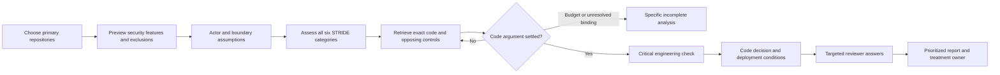

# Feature threat review: product specification

Status: implementation contract, 27 November 2026. Owner: Synthesis engineering. Audience: security champions, application owners and deployment reviewers. This is a product design, not a finding about JCI production.

## Problem and outcome

JCI has a saved multi-repository source graph. The November 27 export contains useful source references but gives the reviewer a large hypothesis register rather than a small set of explainable security decisions. Discovery and engineering assessment have different progress counters, and discovery can consume most of the budget before the missing controls are examined. A source-window limit can leave an available implementation unread. An external-actor display filter does not change the review scope. These distinctions must be visible before spending tokens.

The product must answer: what feature was reviewed, who could misuse it, what trust changes along the path, which controls apply, what the code establishes, what deployment condition changes the decision, and what the owner should do. The output is useful even if no vulnerability is found. The product must never invent twenty threats to satisfy a presentation target.

## Users and decisions

| User | Decision supported |
|---|---|
| Security champion | Accept the scope, assess the argument and prioritize treatment |
| Developer | Inspect exact code, counterevidence and the smallest required change |
| Deployment owner | Answer a specific exposure, identity, configuration or intended-access question |
| Engineering manager | Assign a mitigation owner and see unresolved analysis separately from delivered conclusions |

## Scope contract

1. The reviewer chooses primary repositories by name. No repository name is built into the implementation. API Gateway and MUI are a proposed JCI starting scope, not a product constant.
2. All loaded repositories remain available for supporting evidence. Supporting retrieval never claims that the supporting repository received a complete review.
3. Two explicit modes are retained: **security features** (security-relevant interfaces, workers, stores and authority/configuration surfaces, with reachable implementation context) and **all parsed subjects** (the previous repository-wide review). Changing modes creates a distinct saved scope. Neither is whole-codebase security clearance.
4. Preview states primary repositories, supporting repositories, primary subjects, context-only subjects, unmapped files, categories, planned requests and known limits. Saving or previewing a scope makes no model calls.
5. External priority includes anonymous callers, authenticated ordinary users and compromised peers. Internal paths that enforce an external operation remain part of the investigation. Actor display filters never silently change analysis coverage.
6. A feature grouping is provisional until supported by entries, operations and controls. Grouping by component/file is an organization aid, not proof that endpoints share authorization.

## Review flow

The retrieval loop is bounded. It stops on a settled decision, no new evidence, unavailable source or an explicit resource limit. A blocked case does not prevent unrelated cases from progressing. A failed provider request does not become an evidence conclusion.

## Required assessment content

Every case records the feature, exact operation, actor capability and why that capability is relevant; the asset; the trust transition; the entry-to-operation path; controls and opposing evidence; code citations; outcome; deployment conditions; direct impact; prevention, detection and recovery options; owner; and a validation action. Unknowns remain typed rather than collected into a generic “needs context” statement.

Every selected subject receives six category obligations:

| Category | Required investigation examples |
|---|---|
| Spoofing | Identity issuance, token/session checks, forwarded identity, peer authentication |
| Tampering | Input provenance, writes, command integrity, configuration changes |
| Repudiation | Actor attribution, audit emission, log integrity and failure handling |
| Information Disclosure | Read authority, response/log/export content, secrets and transport |
| Denial of Service | Work amplification, limits, queues, timeouts, retry and resource exhaustion |
| Elevation of Privilege | Role/object authority, service identity, delegation and privileged operations |

No threat is required in every category. “No scenario identified” requires an actual cited assessment of the selected scope. A zero count of findings is not that assessment.

## Decision vocabulary

* **Supported conditional threat:** source supports the entry, sensitive operation, binding and applicable-control analysis. A separate critical check has examined the claimed impact. Conditions and remediation remain explicit.
* **Ruled out for this path:** cited counterevidence blocks the stated attack. This does not clear other actors, entries or deployments.
* **No scenario identified in the reviewed scope:** a category assessment completed with cited scope and controls. This is not proof of security.
* **Incomplete code investigation:** exact missing implementation, binding, unavailable source or retrieval limit; excluded from completed engineering decisions.
* **Deployment decision required:** the code decision is available but applicability depends on a stated effective configuration or intended-use fact. This must not hide missing code.

Design risks and verified code weaknesses remain distinct. CWE remains available, including explicit SD Elements target coverage. Security design concerns do not require a forced CWE mapping.

## Reviewer questions

Questions appear only for deployment or intended-access decisions that source cannot settle. Each includes the affected threat, why the answer matters, “if yes” and “if no” consequences, an unknown option, reviewer name, rationale and profile. Answers are declarations, not live verification, and cannot change a missing-code outcome into supported or ruled out. Changed question text, source revision, assessment or deployment profile invalidates the current answer while preserving history. A reviewer can export partial results without answering.

Example: “Can ordinary authenticated users reach this administrative write operation in profile X?” The answer changes exposure for that actor. It does not establish that another control is absent or approve the boundary.

## Reports and interface

The default sharing report contains scope and what actually ran; feature/STRIDE decision summary; prioritized supported threats; ruled-out paths and cited reasons; the most important deployment decisions; named architecture context; and concise remaining-work counts. The detailed hypothesis register, raw hashes, request history and full code-investigation backlog belong in the technical export. No silent data loss: the report states what is omitted and where to retrieve it.

A threat page explains who can do what, on which path, why controls permit or block it, directly supported impact, deployment conditions and action. Exact code windows accompany citations when source is still hash-matched. Machine identifiers stay in diagnostics. UnitOne branding and “Confidential — Do not share” remain. Pending actors/boundaries explain pending *review confirmation*, not model execution.

Progress distinguishes discovery requests, engineering decisions, failed requests, unresolved code and deployment answers. “Completed requests” never means completed threat modeling. Partial export and resume work without rebuilding unchanged clones.

## Completion and acceptance

An assessed feature has an explicit result for every applicable category and selected subject, no unresolved required code dependency, and traceable evidence. A completed model additionally has its deployment assumptions accepted or explicitly retained, risk treatments owned and remaining scope disclosed. The software may report analysis finished with unresolved cases, but must not label those cases fully analyzed.

Qualification includes supported, blocked and unresolved paths across all six categories; global/inherited authorization; logging; TLS; resource controls; downstream identity; changed-source invalidation; provider failure; cancellation/resume; partial reports; and Windows persistence. The first JCI qualification cohort should contain about twelve representative paths before another portfolio run. That cohort is a qualification sample, never a substitute for the declared scope.

## Success measures and competitive target

Measure expert-adjudicated precision, supported-path recall on a labeled set, category/subject coverage, exact-citation correctness, deployment-question usefulness, reviewer time to a decision, tokens and elapsed time per settled case, and compatible-result reuse. Compare equal scope and provider budgets. Report unknown recall where no ground truth exists.

MDASH is a reference for graph-guided auditors and a separate validation cohort. Its published claims do not establish a comparable complete STRIDE report benchmark. Our target is superior reviewer usefulness and cost per evidence-supported threat-model decision on agreed JCI/static benchmarks. No superiority claim is permitted before that evaluation. Static-only Synthesis does not claim parity with runtime exploit verification.

## Sources

* [OWASP threat modeling](https://cheatsheetseries.owasp.org/cheatsheets/Threat_Modeling_Cheat_Sheet.html): system model, threats, response and validation.
* [AWS SEC01-BP06](https://docs.aws.amazon.com/wellarchitected/latest/framework/sec01-bp06.html): scope, assumptions, prioritization and prevention/detection/response.
* [Azure secure development lifecycle](https://learn.microsoft.com/en-us/azure/well-architected/security/secure-development-lifecycle): controls throughout development and the supply chain.
* [Microsoft MDASH FAQ](https://learn.microsoft.com/en-us/security-exposure-management/codename-mdash-faq): prepare, scan, validate and deduplicate. Consulted 27 November 2026.
